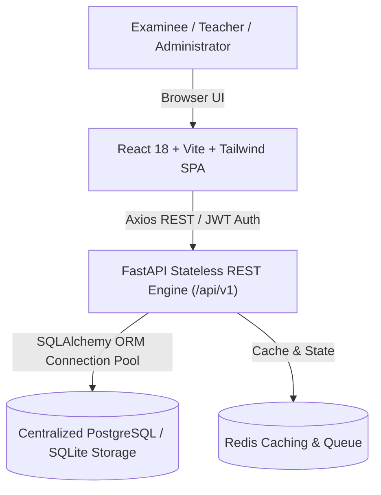
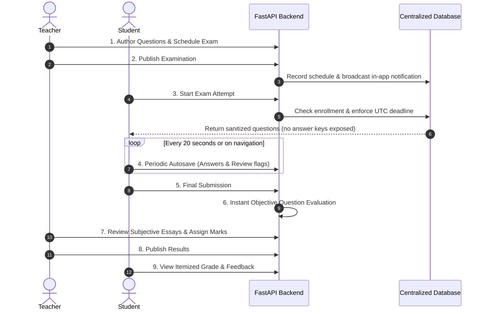

# CloudExam — Cloud-Based Smart Examination System

A complete full-stack web application demonstrating cloud computing concepts: scalable web services, centralized relational storage, asynchronous and objective evaluation, role-based access control, authoritative server-side time enforcement, and support for concurrent examinees.

---

## 1. System Architecture



---

## 2. Examination Lifecycle Flow



---

## 3. Technology Stack

- **Frontend**: React 18, Vite, TypeScript, Tailwind CSS, Lucide React, Recharts, Canvas Confetti.
- **Backend**: Python 3.11+, FastAPI, Pydantic V2, SQLAlchemy 2.0 ORM, PyJWT, Bcrypt.
- **Database**: PostgreSQL 16 (production container) with SQLite fallback for instant zero-dependency local execution.
- **Containerization**: Docker, Docker Compose, Nginx reverse proxy.
- **Testing**: Pytest, TestClient, ASGI transport, Asyncio stress load testing.

---

## 4. Pre-Configured Demo Accounts

For immediate demonstration, 1-click quick-login buttons are provided on the login page and top navbar:

| Role | Username / Email | Password | Privileges |
| :--- | :--- | :--- | :--- |
| **Administrator** | `admin@cloudexam.edu` | `Admin123!` | User management, audit logs, cluster health, system settings. |
| **Teacher** | `teacher@cloudexam.edu` | `Teacher123!` | Create exams, author question banks, grade essays, publish results. |
| **Student** | `student@cloudexam.edu` | `Student123!` | Take assigned exams, view progress, review published results. |

---

## 5. Quickstart & Local Execution

### Step 1: Start Backend API
```bash
# From workspace root
backend\venv\Scripts\python.exe -m uvicorn backend.app.main:app --port 8000 --reload
```
- API Endpoint: `http://127.0.0.1:8000`
- Interactive Swagger UI: `http://127.0.0.1:8000/docs`

### Step 2: Start Frontend Application
```bash
# From frontend folder
cd frontend
npm.cmd run dev
```
- Web Application: `http://localhost:5173`

---

## 6. Docker Deployment

To launch all containerized services (Postgres, Redis, FastAPI backend, and Nginx frontend):

```bash
docker-compose up --build -d
```
Access the application at `http://localhost` (Port 80).

---

## 7. Automated Testing & Verification

Run the comprehensive pytest suite:
```bash
backend\venv\Scripts\python.exe -m pytest backend/tests -v
```
All 6 tests verify authentication, RBAC, question security, autosave idempotency, and the complete 14-step teacher-to-student examination workflow.

Run synthetic candidate load testing:
```bash
backend\venv\Scripts\python.exe scripts/load_test_concurrency.py
```

---

## 8. Documentation Index

- [Architecture & Design Decisions](docs/architecture.md)
- [Database Entity-Relationship Schema](docs/database-design.md)
- [REST API Endpoint Reference](docs/api-guide.md)
- [Deployment, Docker & Backup Guide](docs/deployment-guide.md)
- [Testing & Concurrency Verification](docs/testing-guide.md)
