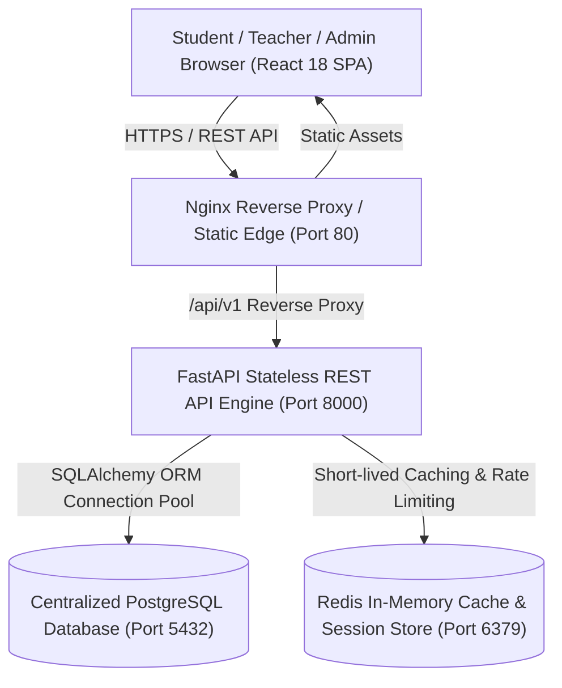
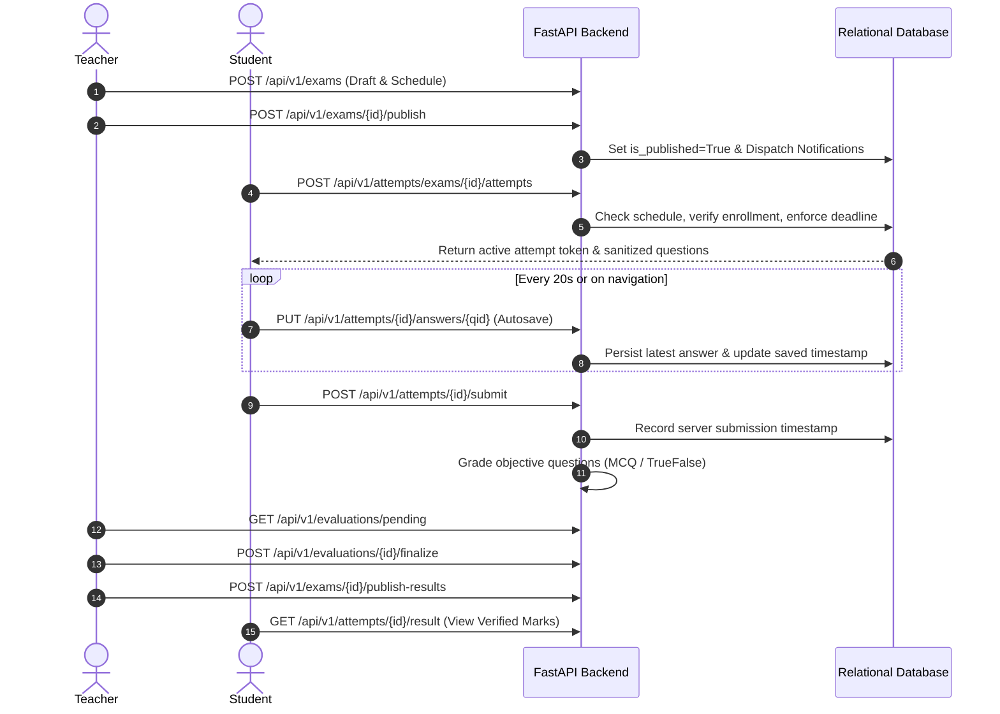

# CloudExam Architecture Specification

## 1. System Overview
CloudExam is an enterprise-grade cloud-native smart examination and academic evaluation platform engineered to demonstrate core cloud computing principles:
- **Stateless Application Tier**: FastAPI backend running with asynchronous ASGI workers, designed for horizontal scale-out behind an ingress load balancer.
- **Centralized Relational Storage**: PostgreSQL cluster managing relational integrity, unique constraints on exam attempts, foreign keys, and transaction-safe grading updates.
- **Authoritative Server Time**: Examination countdown timers, access windows, and deadlines are authoritatively computed on the server using UTC timestamps to prevent client-side clock tampering.
- **Dual-Layer Auto Evaluation Engine**: Immediate vectorized grading of single/multiple choice and true-false objective items, paired with structured rubric grading workflows for subjective descriptive essays.

## 2. Component Topology

## 3. Examination Lifecycle Workflow

